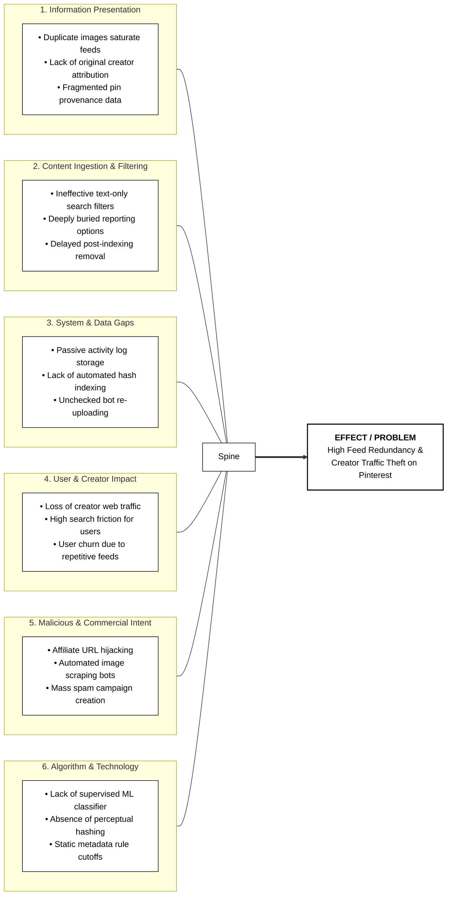

# Part A: Problem Formulation

## A1. Problem Statement

Visual discovery platforms like Pinterest have a copycat problem. Bots and commercial accounts routinely grab popular original artwork and infographics, tweak them just enough to look different (a slight crop, a color filter), and re-upload them with links pointing to their own ad-heavy sites. Picture an independent artist who shares a one-of-a-kind home decor design. Before long, hundreds of spam accounts have posted copies of it, and the original gets buried in search results.

The fallout is real. People searching for fresh ideas keep seeing the same image over and over. Creators lose the traffic and credit they’ve earned. And the platform pays to store countless near-identical files. A machine learning classifier that catches these duplicates before they reach the feed would go a long way toward fixing this.

---

## A2. Users, Stakeholders, and Project Scope

### Target Users and Stakeholders
* **Everyday Pinterest users:** People hunting for inspiration, whether it’s recipes, home decor, or something else, who want varied results instead of the same pin repeated.
* **Content creators and artists:** Original publishers who need credit for their work and want the traffic to land on their own sites.
* **The Trust & Safety team:** The engineers who keep the catalog clean, fight spam, and keep storage costs under control.

### Project Scope

#### In-Scope:
* Pulling together tabular metadata and visual similarity signals, such as perceptual hash distance, aspect ratio, title similarity score, and account age.
* Using a Decision Tree Classifier to sort each new pin into one of three groups: Original, Near-Duplicate, or Exact Duplicate.
* Turning those labels into feed actions: let the pin through, flag it so it can be linked back to the creator, or keep it out of the index.
* Measuring how well the model works using Precision, Recall, and System Response Time.

#### Out-of-Scope:
* Detecting duplicates in video or animated GIFs.
* Generating DMCA takedown notices or handling copyright disputes.
* Building a browser extension from start to finish.
